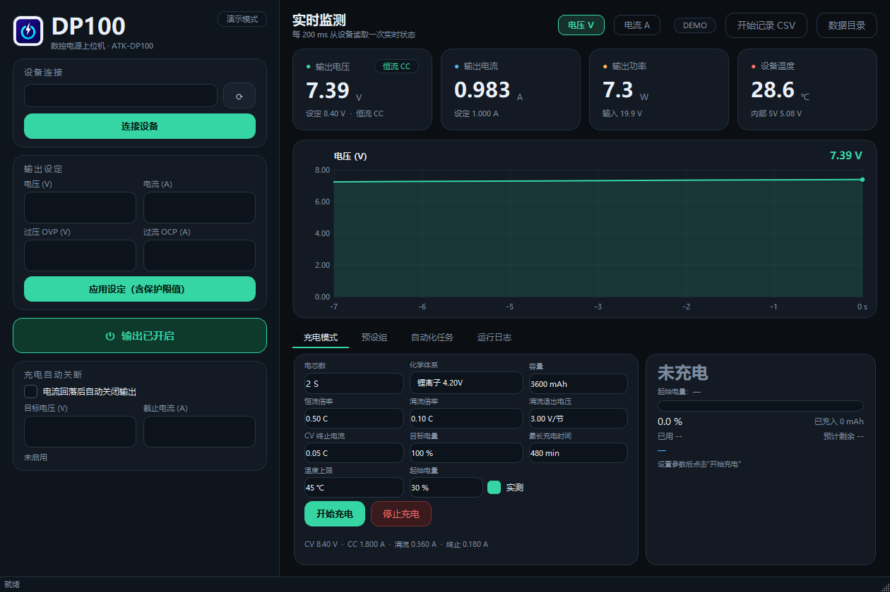

# DP100 数控电源上位机

正点原子 **ATK-DP100**（30 V / 5 A 数控降压电源）的第三方上位机。
自带协议实现，不依赖官方 .NET DLL，无需安装驱动。



## 功能

- **实时监测**：电压 / 电流 / 功率 / 温度，200 ms 刷新
- **曲线可切换**：电压、电流**分开画**（各自独立纵轴自适应），
  电流只有几十 mA 时也不会被电压压成一条平线
- **输出控制**：设定电压、电流、OVP、OCP，一键开 / 关输出
- **预设组**：读取并载入设备 P0–P9 十组预设
- **充电模式**：涓流 → 恒流 → 恒压 三段式；开充实测开路电压、库仑计积分电量、
  指数拟合估算剩余时间，充满后自动校准容量
- **自动化任务**：定时任务（延时 / 每天定时）+ 事件任务（电压 / 电流 / 功率 / 温度触发）
- **CSV 记录**：一键把时间、电压、电流、功率、温度写入 CSV，可直接用 Excel 画图

## 运行

```bash
python -m pip install -r requirements.txt
python main.py
```

常用参数：

```bash
python main.py --demo          # 无设备时用模拟数据预览界面
python main.py --auto-connect  # 启动后自动连接第一台设备
```

## 连接设备

DP100 有两个接口，分工是固定的：

| 接口 | 用途 |
|---|---|
| **Type-C** | 仅输入供电（DC 5–32 V，PD / QC 充电头、充电宝） |
| **USB-A** | 数据通信 + 固件升级，需在菜单里切到 **USBD** 模式 |

连接顺序：**先接 Type-C 等设备开机稳定**，再用「A 对 A 公对公」数据线把 USB-A 接到电脑
（建议插主板后置口）。插上后屏幕面板会自动锁定并显示橙色锁图标，属正常现象。

设备在系统里是 **USB HID**（VID `2E3C` / PID `AF01`），不会出现 COM 口。

> **屏幕显示 LOCK 是正常的。** 只要上位机连上，DP100 就会锁定面板（以电脑为准），
> 面板按键失效并显示橙色锁图标。在软件里断开连接后就恢复。

## 常见问题

**点"关闭输出"没反应 / 电压关不掉？**
已在 v0.1.2 修复。根因是写指令的 index 用错了：官方文档写的 `0xA0`（修改并激活）
在这台固件（HW 1.4 / APP 1.4）上只是回 ACK、并不改变输出状态；实际必须用
**`0x20`（仅修改）配合 state 位**——`state=1` 开输出、`state=0` 关输出。已实测：

```
0x20 state=1 → IOUT 恢复、mode=0x01（恒压）
0x20 state=0 → IOUT=0、mode=0x02（输出关闭）
0x20 vo=8200 → vo_set=8200、VOUT=8.198（改电压同样生效）
```

顺带确认了 `0x30` 状态帧里 `out_mode` 的真实含义：
**`0x00` = 恒流 CC，`0x01` = 恒压 CV，`0x02` = 输出关闭**，
所以界面右上角的模式标签现在直接读这个字段，不再靠电压猜。

**点关闭按钮没反应？**
已在 v0.1.1 修复。旧版关闭时会同步等待后台线程（`BlockingQueuedConnection`），
一旦设备被其他软件占用或掉线、HID 读阻塞，主线程就会一起卡死。
现在传输层改为**重叠 I/O + 超时取消**（不会残留卡死线程），关闭流程改为
**非阻塞 + 超时兜底**，设备无响应时也能在 1 秒内退出。

**提示"无法打开 HID 设备"？**
多半是正点原子官方上位机还开着独占了设备，关掉它再连接。

**读数一直不刷新？**
设备屏幕若同时显示 LOCK 但数据不动，检查 USB-A 线是否为**数据线**（很多线只能充电）。


## 充电模式说明

按 2S 3600 mAh 锂电、0.5 C 恒流为例：

| 参数 | 含义 | 默认值 |
|---|---|---|
| 化学体系 | 单节恒压值：锂离子 4.20 V / 高压锂电 4.35 V / 磷酸铁锂 3.65 V | 锂离子 |
| 电芯数 | 串联节数，CV 目标 = 节数 × 单节恒压 | 2 S |
| 容量 | 用于算倍率和电量 | 3600 mAh |
| 恒流倍率 | CC 电流 = 容量 × 倍率 | 0.5 C |
| 涓流倍率 | 电压低于涓流退出电压时使用的小电流 | 0.1 C |
| 涓流退出电压 | 单节电压达到此值转恒流 | 3.00 V/节 |
| CV 终止电流 | 恒压阶段电流降到该值判定充满 | 0.05 C |
| 目标电压 | 充到该电压视为达到目标（默认 = CV 电压，即 100%） | 8.40 V |
| 最长充电时间 / 温度上限 | 超限自动关输出并报警 | 480 min / 45 ℃ |

**工作流程**

0. **起始电压全自动，不需要你设置**——软件自己测得：
   - 若输出本来就关着：此刻端电压就是静置 OCV，直接采用；
   - 若输出已经开着（带载）：把**电流降到 0 维持约 2 秒**，让表面电荷回落，
     取稳定后的电压作为 OCV；若 1 秒内还在明显回落，界面会标注"可能偏高"。

   这个电压就是起始电压；内部再按 OCV 曲线换算电量用于计算。**充电时端电压（8.39 V 那种）不参与任何计算**，
   它只用于界面显示——这正是最容易搞错的地方：8.4 V 那是电源钳位，不是电池电量。

   > 只有在电池特殊、或你确切知道当前电量时，才勾选表单底部的
   > "高级：手动指定起始电压"来覆盖（默认隐藏）。
1. `涓流预充`：单节电压 < 3.00 V 时用小电流唤醒
2. `恒流充电`：设备 CC，软件按 **库仑计**（积分电流）推进进度与电量
3. `恒压充电`：设备自动转 CV，电流指数衰减
4. `充电完成`：电流降到终止值 → 关输出，并用本次充入量**校准真实容量**（半权重平滑）

**进度与剩余时间怎么算**

| 显示项 | 依据 |
|---|---|
| 进度条 / 百分比 | 已充入 ÷ 本次需要充入（容量 × 目标−起始）—— **与电压无关** |
| 已充入 mAh | 库仑计积分（200 ms 采样） |
| 估算电压 | 由（起始电量 + 已充入÷容量）反查 OCV 曲线得到，界面显示成电压 |
| 剩余时间（恒流段） | 剩余电量 ÷ 当前电流（标注"恒流直算"） |
| 剩余时间（恒压段） | 对 I(t) 做 **ln(I)–t 线性拟合**得时间常数 τ，再算 τ·ln(I/I终止)（标注"恒压指数拟合"） |
| 均流 / Wh | 平均电流、充入能量，便于判断电池健康 |

> 电压估电量的固有精度约 ±10~15%（锂电中段 OCV 曲线很平），所以进度以库仑计为准；
> 起始电压由软件自动测量，一般无需干预；确需覆盖时用表单底部的"高级"选项。

**实测例子（你的 2S 电池）**

```
输出关闭时静置电压      8.171 V   → 起始电压（内部对应约 92.5% 电量）
开始充电后端电压        8.377 V   → 如果直接拿它查表会算成 99.3%（错）
界面实际显示            92.5% + 充入电量，进度按库仑计走（正确）
```

**防误判**：刚进入恒压段 60 秒内、且累计充入不足 2% 时，不会因为瞬时 0 电流
判定"充满"（探测/切换瞬间会出现 0 电流）。

**曲线视图**

右上角有 `电压 V` / `电流 A` 两个切换按钮。电流常只有几十 mA，若和 8 V 画在同一
纵轴上会被压成直线，因此分开显示，纵轴按当前物理量的近期最大值自动取整缩放。
两张视图共享同一份采样数据，切换不会丢历史。

> ⚠️ 设备本身只会恒压恒流输出，**没有任何充电终止逻辑**，所以千万别让它在无人看管时
> 一直挂着。这个软件的充电模式就是用来补上"什么时候断"这一环的。
> 另外软件不负责电芯均衡，2S 电池包请确保自带均衡保护板。

## 自动化任务

任务表存在 `tasks.json`，充电参数存在 `charge_settings.json`，重启后自动恢复。

**事件任务**（上升沿触发，条件不满足后重新满足才会再触发）

| 触发源 | 可选动作 |
|---|---|
| 输出电压 / 输出电流 / 输出功率 / 设备温度 | 关闭输出、打开输出、设定电压、降低电压、升高电压、设定电流 |

例如"充满自动断电"：
- 事件 = 输出电压 `≥` 8.35 V、输出电流 `≤` 0.10 A → 关闭输出

**定时任务**
- 延时执行：N 秒后触发一次
- 每天定时：每天固定时刻触发（如 23:00 关闭输出）

## 目录结构

```
DP100数控电源上位机/        # 本程序独占的目录，和 QT 下其他工程互不干扰
  main.py          # 入口
  requirements.txt
  dp100/
    protocol.py    # 私有 USB-HID 协议：帧结构、CRC16/MODBUS、数据解析
    transport.py   # Windows HID 传输层（重叠 I/O + 超时取消，纯 ctypes）
    worker.py      # 后台线程：轮询状态、下发参数
    charger.py     # 充电状态机 + 库仑计 + 剩余时间估算
    tasks.py       # 定时 / 事件任务引擎
    widgets.py     # 指标卡片、实时曲线
    theme.py       # 深色主题 QSS
    branding.py    # Logo / 窗口图标加载
    main_window.py # 主窗口
    img/logo.png   # 程序 Logo（同时作为窗口与任务栏图标）
  docs/            # 截图
  data/            # CSV 记录输出目录（运行时生成）
  tasks.json       # 自动化任务（运行时生成）
  charge_settings.json  # 充电参数（运行时生成）
```

> 换 Logo 只需替换 `dp100/img/logo.png`（建议正方形 PNG，透明背景），
> 窗口图标与侧边栏图标会自动跟随。

## 协议参考

私有二进制协议（64 字节定长帧，CRC-16/MODBUS 小端）：

```
[方向][OpCode][serial][Len][Data...][CRC lo][CRC hi]
方向: 0xFB 主机→设备,  0xFA 设备→主机
```

| OpCode | 作用 | 载荷 |
|---|---|---|
| `0x10` | 设备信息 | 型号 16B + 硬件/固件/Boot 版本 + SN |
| `0x30` | 实时状态 | vin, vout, iout, vmax, temp1, temp2, aux5v, mode, state（uint16 mV/mA） |
| `0x35` | 预设组读写 | index, state, vo, io, ovp, ocp（index 高位 0x80 查询 / 0xA0 修改并生效） |

参考：[open_dp100 协议分析](https://github.com/lessu/open_dp100/blob/master/DP100_Protocol.md)
